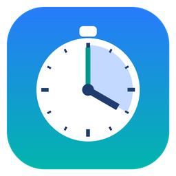
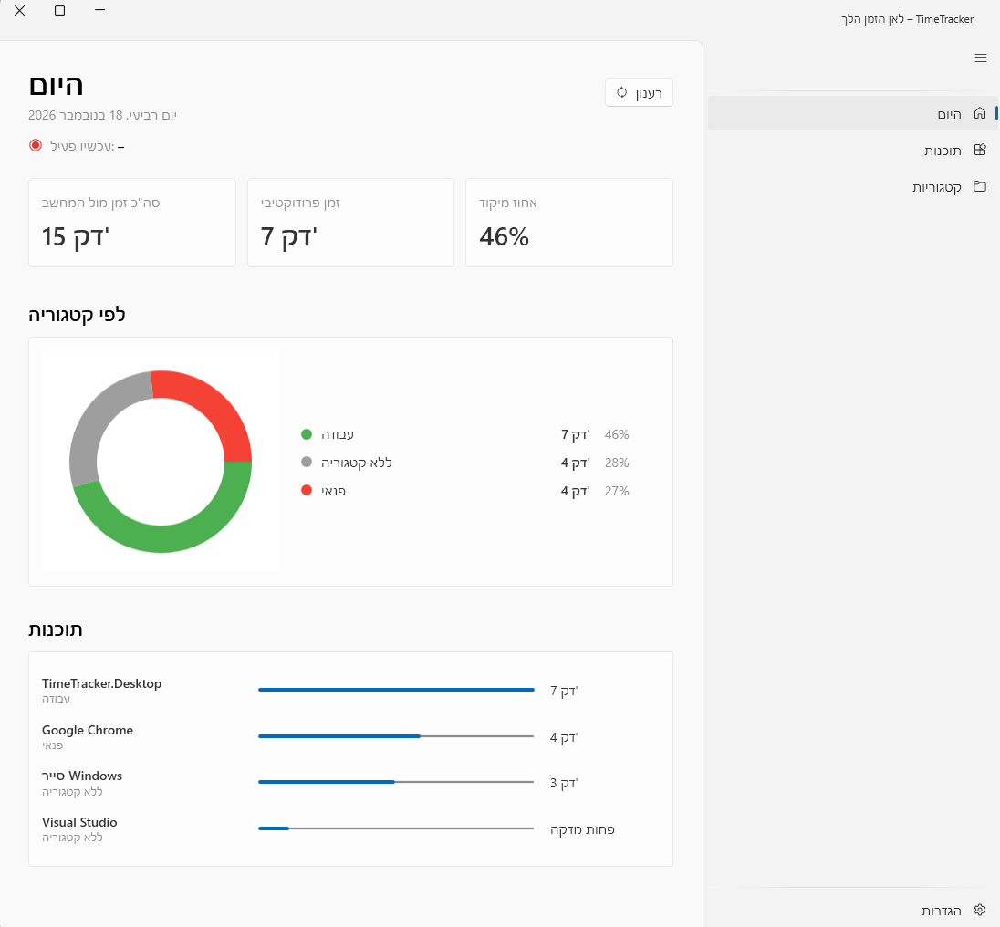
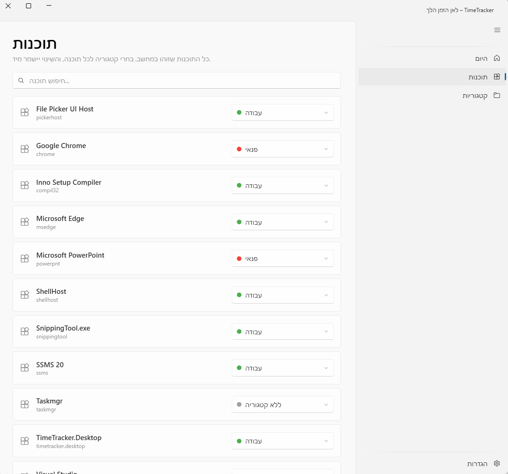
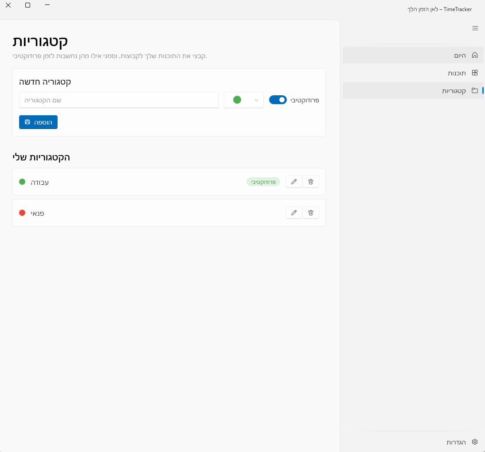
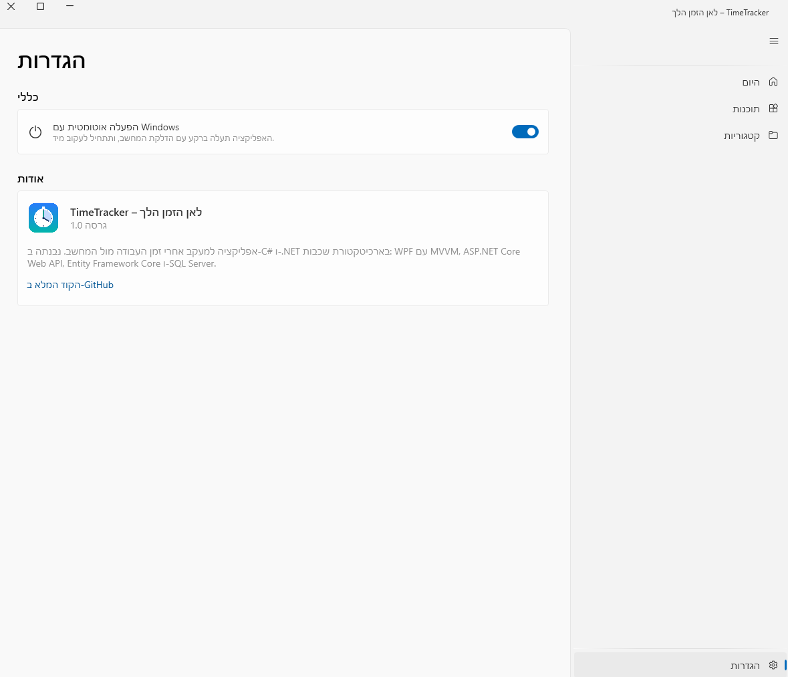
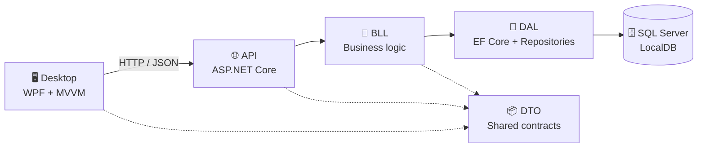
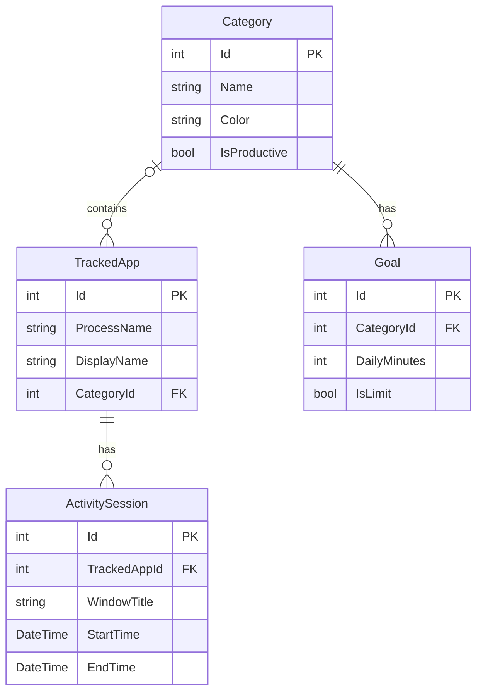

<div align="center">



# TimeTracker

**Where did my time go?** A Windows desktop app that automatically tracks which applications you use, and turns it into clear daily insights.


</div>

---

## 📸 Screenshots

| Today dashboard | Apps |
|---|---|
|  |  |

| Categories | Settings |
|---|---|
|  |  |

---

## ✨ Features

- **Automatic tracking** – detects the active window every 5 seconds and records how long each application was in focus.
- **Idle detection** – time away from the keyboard and mouse (5+ minutes) is not counted.
- **Daily dashboard** – total screen time, productive time, focus percentage, a category donut chart and a ranked list of apps.
- **Categories** – group apps (Work, Study, Leisure…), pick a color, and mark which categories count as productive.
- **Runs in the background** – lives in the system tray; closing the window keeps tracking.
- **Starts with Windows** – optional auto-start, straight to the tray.
- **Modern Windows 11 look** – Fluent design, Mica backdrop, automatic light/dark theme, full right-to-left (Hebrew) UI.
- **One-click installer** – no admin rights required.

---

## 🏗️ Architecture

The solution follows a classic **N-Tier architecture**. Each layer has a single responsibility and talks only to the layer below it.



| Project | Responsibility |
|---|---|
| `TimeTracker.DTO` | Data Transfer Objects – the contracts shared between layers. |
| `TimeTracker.DAL` | Entities, `DbContext`, EF Core migrations and the **Repository pattern**. |
| `TimeTracker.BLL` | Services with validation and business rules (session merging, reports). |
| `TimeTracker.API` | REST API controllers, dependency injection, health check. |
| `TimeTracker.Desktop` | WPF client (MVVM), active-window tracking via Win32, tray icon. |

### Database



A full specification (in Hebrew) is available in [`docs/SPEC.md`](docs/SPEC.md).

---

## 🔍 Engineering highlights

- **Session merging algorithm** – consecutive reports from the same app are merged into one session instead of creating thousands of rows. A new session starts when the app changes **or** when there is a gap longer than 30 seconds (break, sleep).
- **Gap-free switching** – when switching apps, the previous session is closed at the exact switch moment, so no seconds are lost between reports.
- **Day-boundary clipping** – a session that crosses midnight is split correctly between the two days in reports.
- **Win32 interop (P/Invoke)** – `GetForegroundWindow`, `GetWindowThreadProcessId` and `GetLastInputInfo` from `user32.dll`. Only *when* input happened is read – never *what* was typed.
- **Clean MVVM** – views contain no logic; ViewModels use `CommunityToolkit.Mvvm` source generators (`[ObservableProperty]`, `[RelayCommand]`).
- **Dependency Injection** throughout the API; services depend on interfaces, not implementations.
- **Self-hosting** – the desktop app launches the API as a hidden background process, waits for its `/api/health` endpoint, and shuts it down on exit.
- **Zero-setup database** – EF Core migrations run automatically on API startup.
- **Hebrew in charts** – the chart engine (SkiaSharp) renders RTL text incorrectly, so the donut chart is drawn without text and the legend is built in native WPF.
- **Privacy by design** – all data stays on the local machine; the API listens on `localhost` only.

---

## 🛠️ Tech stack

| Area | Technology |
|---|---|
| Language / runtime | C#, .NET 9 |
| Desktop UI | WPF, [WPF-UI](https://github.com/lepoco/wpfui) (Fluent design), [LiveCharts2](https://github.com/beto-rodriguez/LiveCharts2) |
| MVVM | CommunityToolkit.Mvvm |
| API | ASP.NET Core Web API |
| Data access | Entity Framework Core 9, Repository pattern |
| Database | SQL Server LocalDB |
| Installer | Inno Setup 6 |

---

## 📁 Project structure

```
TimeTracker/
├── TimeTracker.DTO/            # Shared data contracts
├── TimeTracker.DAL/
│   ├── Entities/               # Category, TrackedApp, ActivitySession, Goal
│   ├── Repositories/           # Interfaces + EF Core implementations
│   ├── Migrations/
│   └── AppDbContext.cs
├── TimeTracker.BLL/
│   └── Services/               # Category, TrackedApp, Activity, Report services
├── TimeTracker.API/
│   └── Controllers/            # Categories, Apps, Activity, Reports
├── TimeTracker.Desktop/
│   ├── Views/                  # Today, Apps, Categories, Settings pages
│   ├── ViewModels/
│   ├── Tracking/               # Win32 interop + activity tracker
│   ├── Services/               # API client, API launcher, startup manager
│   └── Assets/
├── installer/                  # Inno Setup script
└── docs/                       # Specification + screenshots
```

---

## 🚀 Getting started

### Install (end users)

1. Download `TimeTracker-Setup-x.x.x.exe` from the [**Releases**](../../releases) page.
2. Run it. If Windows SmartScreen appears, click **More info → Run anyway** (the installer is not code-signed).
3. Optionally check **Start with Windows**.

**Requirements:** Windows 10/11 (x64) and [SQL Server Express LocalDB](https://learn.microsoft.com/sql/database-engine/configure-windows/sql-server-express-localdb).

### Build from source (developers)

**Prerequisites:** Visual Studio 2022, .NET 9 SDK, SQL Server LocalDB.

```bash
git clone https://github.com/Mali-Montag-dev/TimeTracker.git
cd TimeTracker
```

1. Open `TimeTracker.sln` in Visual Studio.
2. Right-click the solution → **Configure Startup Projects** → **Multiple startup projects** → set `TimeTracker.API` and `TimeTracker.Desktop` to **Start**.
3. Press **Ctrl+F5**. The database is created automatically on first run.

### Build the installer

```powershell
dotnet publish TimeTracker.Desktop -c Release -r win-x64 --self-contained true -o publish\TimeTracker
dotnet publish TimeTracker.API -c Release -r win-x64 --self-contained true -o publish\TimeTracker\Api
```

Then open `installer/TimeTracker.iss` in Inno Setup and choose **Build → Compile**.

---

## 🗺️ Roadmap

- [ ] Daily goals and limits per category (the `Goal` table is already in place)
- [ ] Weekly / monthly history view
- [ ] Exclude list for private window titles
- [ ] Export reports to CSV
- [ ] Bundle LocalDB with the installer

---

## 📄 License

Released under the [MIT License](LICENSE).

## 👩‍💻 Author

**Mali Montag** – built as a portfolio project to practice N-Tier architecture, REST APIs, EF Core and modern WPF.
