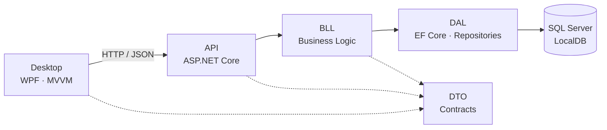
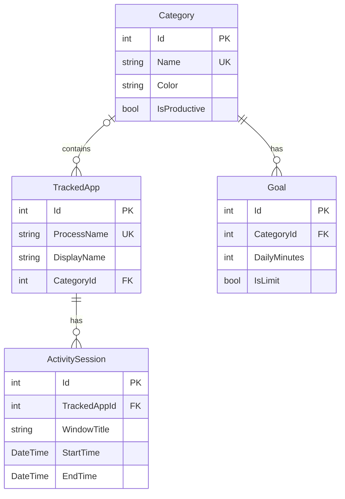

# TimeTracker – מסמך אפיון

| | |
|---|---|
| **גרסה** | 1.0 |
| **סטטוס** | שוחררה |
| **פלטפורמה** | Windows 10/11 (x64) |

---

## 1. סקירה

**TimeTracker** היא אפליקציית שולחן עבודה ל-Windows שמתעדת באופן אוטומטי באילו תוכנות המשתמש עובד, ומציגה ניתוח יומי של זמן העבודה מול המחשב.

**הבעיה:** קשה לדעת בפועל לאן הולך זמן העבודה מול המחשב. כלים קיימים דורשים לרוב דיווח ידני או שולחים נתונים לשרתים חיצוניים.

**הפתרון:** מעקב רציף ושקוף ברקע, ללא התערבות של המשתמש, עם שמירת כל הנתונים מקומית בלבד.

---

## 2. דרישות פונקציונליות

| מזהה | דרישה |
|---|---|
| FR-1 | המערכת תזהה את החלון הפעיל ואת התוכנה שאליה הוא שייך, במרווחים של 5 שניות. |
| FR-2 | המערכת לא תספור זמן שבו אין פעילות של מקלדת או עכבר במשך 5 דקות ומעלה. |
| FR-3 | תוכנה שמזוהה לראשונה תירשם אוטומטית, ללא שיוך לקטגוריה. |
| FR-4 | המשתמש יוכל ליצור, לערוך ולמחוק קטגוריות, ולסמן כל קטגוריה כפרודוקטיבית או לא. |
| FR-5 | המשתמש יוכל לשייך כל תוכנה לקטגוריה, או לבטל את השיוך. |
| FR-6 | המערכת תציג דוח יומי: זמן כולל, זמן פרודוקטיבי, אחוז מיקוד, התפלגות לפי קטגוריה ודירוג תוכנות. |
| FR-7 | האפליקציה תמשיך לפעול ברקע לאחר סגירת החלון, עם אייקון באזור ההודעות. |
| FR-8 | המשתמש יוכל להגדיר הפעלה אוטומטית עם עליית Windows. |
| FR-9 | המערכת לא תתעד את הזמן שבו האפליקציה עצמה נמצאת בפוקוס. |

## 3. דרישות לא-פונקציונליות

| תחום | דרישה |
|---|---|
| פרטיות | כל הנתונים נשמרים מקומית. השרת מאזין ל-`localhost` בלבד. לא נקראות הקשות מקלדת, אלא רק מועד הקלט האחרון. |
| התקנה | התקנה ללא הרשאות מנהל. מסד הנתונים נוצר אוטומטית בהפעלה הראשונה. |
| עמידות | נפילה או היעדרות של השרת לא תפיל את האפליקציה. המעקב ממשיך לנסות בכל מחזור. |
| ביצועים | צריכת משאבים זניחה ברקע: בדיקה אחת כל 5 שניות ובקשת HTTP אחת. |
| ממשק | עיצוב Fluent של Windows 11, התאמה אוטומטית למצב בהיר וכהה, תמיכה מלאה בכיוון מימין לשמאל. |

---

## 4. ארכיטקטורה

המערכת בנויה בארכיטקטורת שכבות (N-Tier). כל שכבה תלויה רק בשכבה שמתחתיה, והתקשורת בין השכבות נעשית באמצעות DTOs.

| שכבה | אחריות | תלויות |
|---|---|---|
| **DTO** | אובייקטי העברת נתונים, ללא לוגיקה | – |
| **DAL** | ישויות, `DbContext`, Migrations ו-Repositories | – |
| **BLL** | ולידציה, חוקים עסקיים, המרה בין ישויות ל-DTOs | DAL, DTO |
| **API** | Controllers, ‏Dependency Injection ו-Health Check | BLL, DTO |
| **Desktop** | ממשק משתמש (MVVM), מעקב אחר החלון הפעיל, הפעלת השרת | DTO (דרך HTTP) |

**הפעלה בסביבת ייצור:** אפליקציית ה-Desktop מפעילה את תהליך ה-API ברקע, ממתינה לנקודת הקצה `/api/health`, וסוגרת את התהליך ביציאה.

---

## 5. מודל נתונים

### Category – קטגוריה

| שדה | טיפוס | אילוצים | תיאור |
|---|---|---|---|
| `Id` | int | PK, Identity | |
| `Name` | nvarchar(50) | חובה, ייחודי | שם הקטגוריה |
| `Color` | nvarchar(9) | חובה | צבע לתצוגה (Hex) |
| `IsProductive` | bit | חובה | האם הזמן בקטגוריה נחשב פרודוקטיבי |

### TrackedApp – תוכנה

| שדה | טיפוס | אילוצים | תיאור |
|---|---|---|---|
| `Id` | int | PK, Identity | |
| `ProcessName` | nvarchar(260) | חובה, ייחודי | שם התהליך במערכת ההפעלה, באותיות קטנות |
| `DisplayName` | nvarchar(200) | חובה | שם לתצוגה, מתוך תיאור הקובץ |
| `CategoryId` | int | FK, רשות | בעת מחיקת קטגוריה: `SET NULL` |

### ActivitySession – פרק פעילות

| שדה | טיפוס | אילוצים | תיאור |
|---|---|---|---|
| `Id` | int | PK, Identity | |
| `TrackedAppId` | int | FK, חובה | התוכנה שהייתה בפוקוס |
| `WindowTitle` | nvarchar(500) | חובה | כותרת החלון בתחילת הפרק |
| `StartTime` | datetime2 | חובה | תחילת הפרק |
| `EndTime` | datetime2 | חובה | סוף הפרק, מתעדכן בכל דיווח |

### Goal – יעד *(מבנה בלבד, ללא ממשק בגרסה 1.0)*

| שדה | טיפוס | אילוצים | תיאור |
|---|---|---|---|
| `Id` | int | PK, Identity | |
| `CategoryId` | int | FK, חובה | בעת מחיקת קטגוריה: `CASCADE` |
| `DailyMinutes` | int | חובה | יעד או מגבלה בדקות |
| `IsLimit` | bit | חובה | `true` למגבלה עליונה, `false` ליעד מינימלי |

---

## 6. חוקים עסקיים

| # | חוק | פירוט |
|---|---|---|
| BR-1 | **איחוד פרקים** | אם הדיווח הנוכחי שייך לאותה תוכנה כמו הפרק האחרון, והפער מאז סוף הפרק קטן מ-30 שניות, מאריכים את `EndTime` במקום ליצור פרק חדש. |
| BR-2 | **סגירה ברגע המעבר** | במעבר לתוכנה אחרת, כשאין הפסקה, הפרק הקודם נסגר בזמן המעבר, כך שאין זמן "אבוד" בין דיווחים. |
| BR-3 | **זיהוי הפסקה** | פער של יותר מ-30 שניות בין דיווחים מתפרש כהפסקה (חוסר פעילות או מצב שינה), ומתחיל פרק חדש. |
| BR-4 | **חיתוך לגבולות יום** | בדוח יומי, פרק שחוצה את חצות נספר רק בחלק שנפל בתוך היום המבוקש. |
| BR-5 | **ולידציית קטגוריה** | שם לא ריק (אחרי הסרת רווחים) ולא כפול. |
| BR-6 | **ולידציית שיוך** | ניתן לשייך תוכנה רק לקטגוריה קיימת. |
| BR-7 | **תוכנות ללא קטגוריה** | בדוח הן מקובצות תחת "ללא קטגוריה" ואינן נחשבות פרודוקטיביות. |

**פרמטרים:**

| פרמטר | ערך |
|---|---|
| מרווח דיווח | 5 שניות |
| סף חוסר פעילות | 5 דקות |
| פער מקסימלי לאיחוד פרקים | 30 שניות |
| רענון אוטומטי של מסך "היום" | 30 שניות |
| סף מינימלי להצגת תוכנה בדוח | 30 שניות |

---

## 7. API

| Method | Endpoint | תיאור | תגובות |
|---|---|---|---|
| GET | `/api/categories` | כל הקטגוריות | 200 |
| GET | `/api/categories/{id}` | קטגוריה לפי מזהה | 200, 404 |
| POST | `/api/categories` | יצירת קטגוריה | 201, 400 |
| PUT | `/api/categories/{id}` | עדכון קטגוריה | 204, 400, 404 |
| DELETE | `/api/categories/{id}` | מחיקת קטגוריה | 204, 404 |
| GET | `/api/apps` | כל התוכנות שזוהו, כולל שם הקטגוריה | 200 |
| PUT | `/api/apps/{id}/category` | שיוך תוכנה לקטגוריה, או ביטול שיוך | 204, 400, 404 |
| POST | `/api/activity/report` | דיווח על החלון הפעיל | 204, 400 |
| GET | `/api/reports/daily?date=` | דוח יומי (ברירת מחדל: היום) | 200 |
| GET | `/api/health` | בדיקת זמינות השרת | 200 |

---

## 8. מסכים

| מסך | תוכן |
|---|---|
| **היום** | כרטיסי סיכום (זמן כולל, זמן פרודוקטיבי, אחוז מיקוד), תרשים דונאט לפי קטגוריה, רשימת תוכנות מדורגת, התוכנה הפעילה כרגע |
| **תוכנות** | כל התוכנות שזוהו, חיפוש, ושיוך לקטגוריה עם שמירה מיידית |
| **קטגוריות** | יצירה, עריכה ומחיקה, בחירת צבע וסימון פרודוקטיביות |
| **הגדרות** | הפעלה אוטומטית עם Windows, ופרטי גרסה |
| **אזור ההודעות** | פתיחת החלון ויציאה מהאפליקציה |

---

## 9. טכנולוגיות

| תחום | טכנולוגיה |
|---|---|
| שפה וסביבת ריצה | C#, .NET 9 |
| ממשק משתמש | WPF, WPF-UI (Fluent), LiveCharts2 |
| MVVM | CommunityToolkit.Mvvm |
| שרת | ASP.NET Core Web API |
| גישה לנתונים | Entity Framework Core 9, Repository Pattern |
| מסד נתונים | SQL Server LocalDB |
| התקנה | Inno Setup 6 |
| ניהול גרסאות | Git, GitHub |

---

## 10. גרסאות

### גרסה 1.0 (שוחררה)
כל הדרישות FR-1 עד FR-9, קובץ התקנה, והפעלה אוטומטית.

### תכנון לגרסאות הבאות
- ממשק ליעדים ולמגבלות יומיות (מבנה הנתונים כבר קיים)
- היסטוריה שבועית וחודשית
- רשימת החרגה לכותרות חלונות פרטיות
- ייצוא דוחות ל-CSV
- הכללת LocalDB בקובץ ההתקנה

