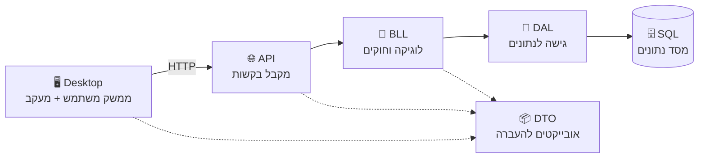
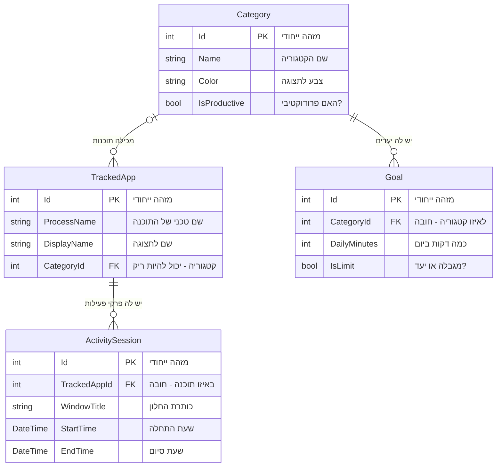

# ⏱️ TimeTracker – דף אפיון

> **TimeTracker** ("מעקב זמן") – אפליקציית Windows שעוקבת ברקע אחרי התוכנות שבהן אני משתמשת, ומציגה דוחות על איך עבר היום שלי מול המחשב.

---

## 1. מה האפליקציה עושה?

| # | יכולת | הסבר |
|---|---|---|
| 1 | **מעקב אוטומטי** | כל כמה שניות האפליקציה בודקת איזה חלון פתוח וממוקד כרגע, ורושמת את זה. |
| 2 | **זיהוי חוסר פעילות** | אם לא נגעתי בעכבר או במקלדת כמה דקות – הזמן הזה לא נספר. |
| 3 | **קטגוריות** | אפשר לשייך כל תוכנה לקטגוריה (עבודה, לימודים, הסחות דעת...). |
| 4 | **דוחות** | דוח יומי ושבועי: כמה זמן בכל תוכנה ובכל קטגוריה, עם גרפים. |
| 5 | **יעדים** | אפשר להגדיר יעד ("לפחות 4 שעות עבודה ביום") או מגבלה ("לא יותר משעה ברשתות"). |
| 6 | **ריצה ברקע** | האפליקציה יושבת כאייקון קטן ליד השעון ולא מפריעה. |

---

## 2. ארכיטקטורה – מבנה השכבות

הפרויקט בנוי ב**ארכיטקטורת שכבות** (N-Tier). כל שכבה אחראית על דבר אחד בלבד, ומדברת רק עם השכבה שמתחתיה.

| פרויקט | שם מלא באנגלית | פירוש בעברית | תפקיד |
|---|---|---|---|
| `TimeTracker.DTO` | Data Transfer Objects | אובייקטים להעברת נתונים | "מעטפות" שבהן הנתונים עוברים בין השכבות. בלי לוגיקה. |
| `TimeTracker.DAL` | Data Access Layer | שכבת גישה לנתונים | היחידה שמדברת עם מסד הנתונים. שומרת ושולפת. |
| `TimeTracker.BLL` | Business Logic Layer | שכבת הלוגיקה העסקית | ה"מוח": מחליטה מה לעשות עם הנתונים (חישובים, חוקים, בדיקות). |
| `TimeTracker.API` | Application Programming Interface | ממשק תכנות | "דלת כניסה" – מקבל בקשות מהממשק ומעביר ל-BLL. |
| `TimeTracker.Desktop` | – | אפליקציית שולחן עבודה | מה שהמשתמשת רואה (WPF), וגם רכיב המעקב שרץ ברקע. |

**למה ככה?** אם מחר נרצה להחליף את מסד הנתונים – משנים רק את ה-DAL. אם נרצה אפליקציית מובייל – היא תדבר עם אותו API. כל חלק עצמאי.

---

## 3. מסד הנתונים – תרשים טבלאות (ERD)

**ERD** = Entity Relationship Diagram = **תרשים ישויות וקשרים**. הוא מראה אילו טבלאות יש ואיך הן קשורות זו לזו.

### איך קוראים את הקווים בתרשים?

| סימן | משמעות |
|---|---|
| `\|\|` | בדיוק אחד (חובה) |
| `\|o` | אפס או אחד (רשות – יכול להיות ריק) |
| `o{` | אפס או הרבה |
| **PK** | Primary Key – מפתח ראשי |
| **FK** | Foreign Key – מפתח זר |

---

## 4. הטבלאות בפירוט

### 📁 `Category` – קטגוריה

**מה זה?** קבוצה של תוכנות עם אופי דומה. למשל: "עבודה", "לימודים", "הסחות דעת".

| שדה (באנגלית) | פירוש | טיפוס | הסבר | דוגמה |
|---|---|---|---|---|
| `Id` | מזהה | `int` (מספר שלם) | מספר ייחודי לכל קטגוריה. נוצר אוטומטית. | `1` |
| `Name` | שם | `string` (טקסט) | שם הקטגוריה. | `"עבודה"` |
| `Color` | צבע | `string` (טקסט) | קוד צבע לגרפים. | `"#4CAF50"` (ירוק) |
| `IsProductive` | האם פרודוקטיבי | `bool` (כן/לא) | האם זמן בקטגוריה הזו נחשב "זמן טוב". | `true` (כן) |

---

### 💻 `TrackedApp` – תוכנה במעקב

**מה זה?** כל תוכנה שהאפליקציה זיהתה אי-פעם במחשב. כל תוכנה מופיעה **פעם אחת בלבד** בטבלה.

| שדה (באנגלית) | פירוש | טיפוס | הסבר | דוגמה |
|---|---|---|---|---|
| `Id` | מזהה | `int` | מספר ייחודי לכל תוכנה. | `5` |
| `ProcessName` | שם התהליך | `string` | השם הטכני ש-Windows נותן לתוכנה. | `"chrome"` |
| `DisplayName` | שם לתצוגה | `string` | שם יפה וקריא. | `"Google Chrome"` |
| `CategoryId` | מזהה קטגוריה | `int?` (מספר **או ריק**) | לאיזו קטגוריה התוכנה שייכת. **ריק** כשתוכנה חדשה ועוד לא שויכה. | `1` או ריק |

---

### ⏱️ `ActivitySession` – פרק פעילות

**מה זה?** פרק זמן **רצוף** שבו תוכנה אחת הייתה פתוחה וממוקדת. ברגע שעוברים לתוכנה אחרת – נפתח פרק חדש.

| שדה (באנגלית) | פירוש | טיפוס | הסבר | דוגמה |
|---|---|---|---|---|
| `Id` | מזהה | `int` | מספר ייחודי לכל פרק. | `101` |
| `TrackedAppId` | מזהה תוכנה | `int` (**חובה**) | באיזו תוכנה הייתי. פרק פעילות תמיד שייך לתוכנה. | `5` |
| `WindowTitle` | כותרת החלון | `string` | הטקסט בראש החלון – נותן פירוט. | `"GitHub - Google Chrome"` |
| `StartTime` | זמן התחלה | `DateTime` (תאריך + שעה) | מתי התחיל הפרק. | `17/11/2026 09:00:00` |
| `EndTime` | זמן סיום | `DateTime` | מתי הסתיים. מתעדכן כל עוד התוכנה פעילה. | `17/11/2026 09:45:00` |

---

### 🎯 `Goal` – יעד

**מה זה?** מטרה יומית עבור קטגוריה.

| שדה (באנגלית) | פירוש | טיפוס | הסבר | דוגמה |
|---|---|---|---|---|
| `Id` | מזהה | `int` | מספר ייחודי לכל יעד. | `1` |
| `CategoryId` | מזהה קטגוריה | `int` (**חובה**) | לאיזו קטגוריה היעד. יעד תמיד שייך לקטגוריה. | `3` |
| `DailyMinutes` | דקות ביום | `int` | מספר הדקות. | `60` |
| `IsLimit` | האם מגבלה | `bool` | `true` = **מגבלה** ("לא יותר מ-"), `false` = **יעד** ("לפחות"). | `true` |

---

## 5. הקשרים בין הטבלאות – במילים

| קשר | סוג | הסבר | חובה או רשות? |
|---|---|---|---|
| `Category` ← `TrackedApp` | אחד לרבים | לקטגוריה אחת יכולות להיות **הרבה** תוכנות. לכל תוכנה יש **לכל היותר** קטגוריה אחת. | **רשות** – תוכנה יכולה להיות בלי קטגוריה |
| `TrackedApp` ← `ActivitySession` | אחד לרבים | לתוכנה אחת יש **הרבה** פרקי פעילות. כל פרק שייך לתוכנה **אחת**. | **חובה** – אין פרק בלי תוכנה |
| `Category` ← `Goal` | אחד לרבים | לקטגוריה יכולים להיות **כמה** יעדים. כל יעד שייך לקטגוריה **אחת**. | **חובה** – אין יעד בלי קטגוריה |

---

## 6. דוגמה – איך הנתונים מתחברים בפועל

כך ייראו הטבלאות אחרי בוקר עבודה קצר:

**Category**

| Id | Name | Color | IsProductive |
|---|---|---|---|
| 1 | עבודה | #4CAF50 | true |
| 2 | הסחות דעת | #F44336 | false |

**TrackedApp**

| Id | ProcessName | DisplayName | CategoryId |
|---|---|---|---|
| 5 | devenv | Visual Studio | **1** ← עבודה |
| 6 | chrome | Google Chrome | **2** ← הסחות דעת |
| 7 | notepad | Notepad | *(ריק – עוד לא שויך)* |

**ActivitySession**

| Id | TrackedAppId | WindowTitle | StartTime | EndTime |
|---|---|---|---|---|
| 101 | **5** ← Visual Studio | TimeTracker - Microsoft Visual Studio | 09:00 | 09:45 |
| 102 | **6** ← Chrome | YouTube - Google Chrome | 09:45 | 09:55 |
| 103 | **5** ← Visual Studio | TimeTracker - Microsoft Visual Studio | 09:55 | 10:30 |

**Goal**

| Id | CategoryId | DailyMinutes | IsLimit |
|---|---|---|---|
| 1 | **2** ← הסחות דעת | 30 | true → "לא יותר מ-30 דקות" |

**מה אפשר להסיק מזה?**
- ב-Visual Studio: 45 + 35 = **80 דקות** → קטגוריית "עבודה".
- ב-Chrome: **10 דקות** → קטגוריית "הסחות דעת".
- היעד "לא יותר מ-30 דקות הסחות דעת" – **עומד בו** ✅.

את החישובים האלה תעשה שכבת ה-**BLL**.

---

## 7. חוקים עסקיים (מה ה-BLL יעשה)

| # | חוק | הסבר |
|---|---|---|
| 1 | **איחוד פרקים** | אם התוכנה הפעילה לא השתנתה מאז הבדיקה הקודמת – מאריכים את `EndTime` של הפרק הנוכחי במקום ליצור פרק חדש. |
| 2 | **תוכנה חדשה** | אם מזוהה `ProcessName` שלא קיים בטבלה – יוצרים `TrackedApp` חדש בלי קטגוריה. |
| 3 | **חוסר פעילות** | אם לא הייתה פעילות עכבר/מקלדת יותר מ-5 דקות – סוגרים את הפרק ולא סופרים את הזמן. |
| 4 | **בדיקת יעדים** | מחשבים סך דקות לכל קטגוריה היום ומשווים ל-`Goal`. |
| 5 | **ולידציה** | שם קטגוריה לא ריק ולא כפול; `DailyMinutes` בין 1 ל-1440 (מספר הדקות ביממה). |

---

## 8. מילון מונחים

| מונח באנגלית | בעברית | הסבר פשוט |
|---|---|---|
| **Entity** | ישות | מחלקת C# שמייצגת טבלה. כל אובייקט = שורה. |
| **Property** | מאפיין | משתנה בתוך מחלקה (`{ get; set; }`). בישות – כל מאפיין = עמודה. |
| **Primary Key (PK)** | מפתח ראשי | עמודה שמזהה כל שורה באופן ייחודי. אצלנו תמיד `Id`. |
| **Foreign Key (FK)** | מפתח זר | עמודה שמצביעה על שורה בטבלה **אחרת**. למשל `CategoryId`. |
| **Navigation Property** | מאפיין ניווט | "קיצור דרך" מאובייקט אחד לאובייקט קשור. לא נשמר כעמודה. למשל `app.Category.Name`. |
| **One-to-Many** | אחד לרבים | שורה אחת בטבלה א' קשורה להרבה שורות בטבלה ב'. |
| **Nullable** (`?`) | יכול להיות ריק | `int?` = מספר או "אין ערך" (null). |
| **null** | ריק / אין ערך | המצב שבו למשתנה אין שום ערך. |
| **`null!`** | "סמוך עליי" | אומר לקומפיילר: "זה ריק עכשיו, אבל EF ימלא את זה". |
| **Entity Framework (EF)** | – | ספרייה שמתרגמת בין מחלקות C# לטבלאות SQL. |
| **DbContext** | הקשר מסד הנתונים | המחלקה שמחברת את הישויות למסד הנתונים. |
| **Migration** | הגירה | קובץ ש-EF יוצר, שמתאר איך לבנות/לשנות את הטבלאות. |
| **LocalDB** | – | גרסה קלה של SQL Server שרצה על המחשב המקומי. |
| **Solution** | פתרון | ה"מעטפת" שמחזיקה את כל הפרויקטים יחד. |
| **Reference** | הפניה | הרשאה לפרויקט אחד להשתמש בקוד של פרויקט אחר. |
| **Commit** | שמירה | נקודת שמירה ב-Git עם תיאור של מה השתנה. |
| **Push** | דחיפה | העלאת ה-Commits מהמחשב ל-GitHub. |

---

## 9. טכנולוגיות

| טכנולוגיה | שימוש |
|---|---|
| C# / .NET 9 | שפת התכנות והפלטפורמה |
| WPF | ממשק המשתמש (Windows Presentation Foundation) |
| ASP.NET Core Web API | שכבת ה-API |
| Entity Framework Core 9 | גישה למסד הנתונים |
| SQL Server LocalDB | מסד הנתונים |
| Git + GitHub | ניהול גרסאות ותיעוד |

---

## 10. התקדמות

- [x] הקמת מאגר GitHub
- [x] יצירת Solution עם 5 פרויקטים וחיבור השכבות
- [x] ישויות DAL: `Category`, `TrackedApp`, `ActivitySession`, `Goal`
- [ ] DbContext ויצירת מסד הנתונים
- [ ] DTO ו-BLL
- [ ] API
- [ ] מעקב אחרי חלון פעיל (Desktop)
- [ ] מסכים, דוחות וגרפים
- [ ] קובץ התקנה
- [ ] README וצילומי מסך

